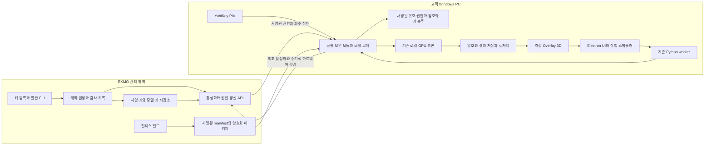

# EXMO Desktop 라이선스와 모델 보호 설계

후속 제품화 설계(2026-10-17): [솔루션별 권한·선택 설치·계정·결과 동기화](EXMO_SOLUTION_PRODUCTIZATION_DESIGN.md). PC/YubiKey 분석 권한과 기관 계정의 서버 결과 접근권을 분리하는 **계획**이며, 아래 기존 구현이 이미 전환됐다는 뜻은 아니다.

- 작성일: 2026-10-15
- 검토 기준: `ac0998e`, 앱 `0.1.24`, Windows x64 / Electron / Python CT·MRI·AP·LAT 환경
- 상태 (2026-10-16): 전체 모델 암호화·작업별 허가, 고객 PC+YubiKey 이중 키, 결과 보호·기관 복구, 서명 payload·설치본 검사·운영 CLI 구현. 실물 동글·실제 서버·코드 서명·신규 PC 현장 검증은 미완료. 최신 구현과 검증 증거는 [제품 보안 runbook](EXMO_PRODUCT_SECURITY_RUNBOOK.md)에 있다.

구현 진행: [YubiKey 검증 도구](EXMO_SECURITY_POC_RUNBOOK.md), [내부용 라이선스 운영·검증](EXMO_LICENSE_POC_RUNBOOK.md). 내부용은 실제 CNG software KSP 서명과 DPAPI 상태 저장을 사용한다. 고객 동글 흐름은 합성 키로 검증했고 모델 strict loader는 실제 가중치로 대조했다. 아래 내용은 설계 목표와 한계를 포함하며 제품 runbook의 검증 목록이 구현 상태의 기준이다.

**기본 설계는 온라인 우선 + YubiKey 인증 + 제한적인 오프라인 유예다.** 최초 활성화와 정기적인 사용 권한 갱신은 EXMO 서버에서 수행한다. 인터넷·서버 장애 시에는 마지막으로 승인된 유효 권한과 등록된 YubiKey로 일시적인 오프라인 분석을 허용한다. 공통 보안 모듈을 기존 Python 분석 경로에 연결하고 모델 암호화와 결과 마스크 보호를 함께 구현한다. CT·MRI·X-ray의 계산 설정과 현재 화면 동작은 유지한다.

[공유 구축안](https://chatgpt.com/share/6ad0388c-4fd4-83ee-a2c9-522c7c490df2)의 하드웨어 인증·키 분리·모델 보호 제안을 반영하되, 운영 정책은 이후 사용자가 검토한 온라인 우선 방향으로 갱신한다. 앞선 초안의 무기한 오프라인 영구 라이선스는 기본 배포 정책에서 제외한다. **현재 구현은 서버 발급 유예를 최대 7일로 제한한다.** 이 수치의 판매 계약 확정과 PC 시계 조작 방어는 별개다. 영구 판매 또는 구독 판매의 선택도 미정이다. 영구 사용권을 판매하더라도 주기적인 온라인 확인이 필요하다는 조건을 계약과 제품 안내에 명시해야 한다.

### 정책 기준과 미확정 값

| 항목 | 설계 기준 | 확정 상태 |
| --- | --- | --- |
| 서버의 역할 | 계약·만료·허용 기능·등록 PC·분실 동글·회수 상태의 기준 | 기본 방향 |
| YubiKey의 역할 | 등록 하드웨어 키 소유 증명과 모델 키 봉투 해제. 서버의 사용 권한 판정을 대체하지 않음 | 기본 방향, 실물 검증 필요 |
| 최초 활성화 | 온라인 필수. 설치 파일 복사는 오프라인에서도 가능 | 기본 방향 |
| 평소 갱신 | 앱 시작·절전 복귀·재연결 시 시도, 실행 중 주기적 갱신 | 기본 방향; 주기 5분은 PoC 후보 |
| 오프라인 유예 | 마지막 성공한 서버 승인 시점부터 유한한 기간, 계약 만료를 넘기지 않음 | 기간 7일은 정책 후보 |
| 동글 확인 | 온라인·오프라인 모두 신규 분석마다 새 증명, 모델 캐시 재사용도 동일 | 기본 방향 |
| 권한 상실 | 신규 분석 차단, 이미 실행을 시작한 케이스는 제한된 완료 처리 | 기본 방향 |
| 완료 결과 | 열람·허용된 내보내기·복구를 분석 사용권과 분리 | 기본 방향 |
| 환자 데이터 | 로컬 GPU 분석. 라이선스 서버에 환자 영상·식별자·결과를 보내지 않음 | 기본 방향 |
| 시간·회수 보장 | 오프라인 중 즉시 회수와 관리자에 의한 시계·상태 조작의 완전 차단은 보장하지 않음 | 명시할 한계 |

서버가 서명한 정책 값만 실행에 사용한다. 후보 숫자를 클라이언트의 수정 가능한 설정이나 장애 시 임의 기본값으로 대체하지 않는다. 구현하지 않은 보안 기능을 현재 설치본의 기능으로 안내하지 않는다.

### 승인된 내부 개발 장비의 예외

내부 개발 PC·서버는 별도 `internal` profile과 발급 키로 승인하고 동글 없이 Windows 설치 키로 인증한다. 내부용 패키지는 서버 공개키·profile·주소를 고정하며 고객 profile과 교차 수용하지 않는다. EXMO 서버 운영자가 장비와 만료일을 승인한다. Windows 관리자 설치, 환경변수, 공용 Admin 암호로 인증을 끄는 방식은 허용하지 않는다.

내부용도 최초 온라인 활성화·유한한 유예·계약 만료·회수·매 분석 설치 증명을 적용한다. 내부용 app ID와 결과 저장 위치를 고객/기존 개발 앱과 분리한다. CNG software KSP의 내보내기 금지와 DPAPI를 구현했지만 TPM 보안이나 같은 사용자 공격의 완전 방어로 표시하지 않는다. 소스 개발 실행은 유지하며 무보호 소스 실행본을 제품 패키지로 만들지 못하도록 빌드 검사와 고객 출시 차단을 둔다.

모델 암호화 연결에서는 내부용 전용 설치 복호화 키에 봉투를 묶고, 고객용은 PC + YubiKey 조건을 유지한다. profile·수신 키·model/recipe digest를 서명해 교차 복호화를 막아야 한다. 현재 설치 키는 서명 전용이다. 키 봉투·암호화 로더를 구현한 것으로 간주하지 않는다.

이하 YubiKey 필수 조건은 고객용 기준이며, 내부용에는 위의 승인된 설치 키 예외를 적용한다. 고객 출시 전 통과 조건은 예외로 생략하지 않는다.

## 1. 기존 논의에서 바꾸는 부분

| 항목 | 이번 설계 |
| --- | --- |
| Sentinel / CodeMeter 중심 후보 | YubiKey 5C NFC / 5C Nano의 PIV 인증을 우선 검증한다. 상용 라이선스 플랫폼 계약은 기본 전제에서 제외한다. |
| 동글 인증 방식 | USB 일련번호 대조 대신 내부 생성 ECDSA P-256 키로 challenge에 서명한다. |
| 발급 권한 | EXMO 발급 키와 고객 YubiKey 인증 키를 분리한다. 고객 PC·동글에 발급 마스터 개인키를 넣지 않는다. |
| 오프라인 우선 제안 | 최초 온라인 활성화·주기적 서버 갱신을 기본으로 한다. 유효한 서명 권한이 있을 때만 제한적인 오프라인 유예를 허용한다. |
| 동글만 있으면 사용 가능 | 서버 승인 권한 + 등록 PC + 매 분석 YubiKey 증명을 모두 확인한다. |
| 7일 유예 | 마지막 서버 승인부터 계산하는 후보 값이다. 장애 시작·앱 재시작부터 새로 7일을 주지 않는다. |
| 세 개의 대형 신규 프로그램 | 발급·관리, 키 등록, 실행 검증의 책임은 분리하되 관리자 React 화면과 범용 제품 플랫폼부터 만들지 않는다. 첫 단계는 작은 관리 API·발급 CLI·공통 실행 모듈이다. |
| 인증 성공이면 모델 보호 완료 | 인증·패키지 암호화·실행 중 보호·결과 저장을 각각 검증한다. YubiKey는 GPU 추론이나 Python 코드 보호를 대신하지 않는다. |
| USB 제거 즉시 앱 종료 | 새 작업을 차단하고 이미 승인되어 시작한 케이스만 안전하게 완료한다. 완료 결과와 원본은 보존한다. |
| 4~6주 등 일괄 일정 | 실물 동글과 모델 로더 PoC 통과 후 단계별 일정을 산정한다. 관리 화면 개발을 인증 실험의 선행 조건으로 두지 않는다. |

공유안의 구매 가격·환율·할인율과 의료기기 변경 신고에 대한 법적 해석은 이 설계의 확정 근거로 사용하지 않는다. 조달과 제품별 변경 영향평가는 별도 업무다.

## 2. 현재 코드에서 확인한 연결 지점과 위험

| 우선도 | 현재 상태와 근거 | 설계에 미치는 영향 |
| --- | --- | --- |
| 출시 차단 | [이관 생성기](../scripts/build-desktop-transfer.py)가 원본 모델 archive, Python 소스, `source.zip`을 복사한다. archive에는 개발 샘플·reference mask가 포함된다. | 고객 패키지는 명시한 실행 파일과 암호화 자산만 허용한다. 기존 개발용 이관 묶음을 그대로 납품하지 않는다. |
| 출시 차단 | [model-service.py](../desktop/model-service.py)의 `run`, [model-runner.py](../desktop/model-runner.py)의 CLI, [classifier-worker.py](../desktop/classifier-worker.py)의 분류에 권한 검사가 없다. | UI 버튼만 잠그면 직접 호출·캐시 재사용 경로가 남는다. 실제 실행 지점에서 같은 정책을 확인한다. |
| 출시 차단 | [imaging-worker.py](../desktop/imaging-worker.py)의 `finalize`, 좌우 분리, MRI variant는 일반 NRRD/NIfTI를 읽고 쓴다. | 가중치 암호화와 별개로 마스크·확률·임시 파일의 저장 경로를 보호해야 한다. |
| 높음 | [model-runner.py](../desktop/model-runner.py)의 MRI Windows 처리가 `inspect.getsource`와 `exec(compile(...))`를 사용한다. `with_globals`도 Python 함수 내부에 의존한다. | 보호·컴파일 도구를 먼저 적용하면 깨질 수 있다. Windows 보정을 빌드 시 확정하고, 함수 교체 동작을 보존한 뒤 보호 범위를 결정한다. |
| 높음 | [imaging.cjs](../desktop/imaging.cjs)는 GPU→CPU 인계 중 다른 케이스를 실행하고, 측정·Overlay를 먼저 공개한 뒤 3D를 만든다. 취소는 worker 전체를 종료한다. | 권한 상실을 기존 전체 취소에 연결하지 않는다. 실행 허가와 대기열 차단을 분리한다. |
| 높음 | [analysis-worker.cjs](../desktop/analysis-worker.cjs)는 worker stdout을 그대로 로그에 쓴다. `job.json`도 디스크에 저장된다. | 키·허가 토큰을 기존 JSON 이벤트·작업 파일·환경변수에 넣지 않는다. |
| 높음 | [설치기](../scripts/install-desktop-transfer.ps1)는 설치 후 `model-runner.py`를 다시 덮어쓴다. | 고객 릴리스는 최종 파일을 만든 뒤 서명하고, 설치 후 임의 소스 덮어쓰기를 없앤다. |
| 유지 | [main.cjs](../desktop/main.cjs)는 sandbox·context isolation·CSP·좁은 GLB 경로를 사용한다. | 보안 서버 연결은 renderer 밖에서 처리한다. `fs`·키·임의 IPC를 renderer에 노출하지 않는다. |
| 유지 | `0.1.24`의 [results-export.cjs](../desktop/results-export.cjs)는 측정·QC·식별자 Excel을, [image-menu.cjs](../desktop/image-menu.cjs)는 PNG·클립보드·식별자 CSV를 내보낸다. | 현재 기능은 원본 마스크 내보내기와 구분한다. 식별자·영상이 포함되므로 자동 익명화라고 표시하지 않는다. |

기존 [제품 방향](EXMO_PRODUCT_ARCHITECTURE.md)과 [개발 준비](EXMO_DEVELOPMENT_READINESS.md)의 초기 구현 현황은 역사적 기록이다. 보안 연결 지점은 위 커밋을 기준으로 삼는다. `06d28dd` 이후 변경을 대조했으며 모델·파이프라인·이관 스크립트의 관련 경로는 동일하고, `0.1.24`의 이미지 복사 및 assembled/exploded view 연동도 보존 대상이다. 특히 예전 이관 문서의 CT CPU 전용 설명보다 [현재 CT 실행 정책](EXMO_CT_INPUT_RESIDENCY_2026-10-05.md)이 우선한다.

## 3. 보호 목표와 신뢰 경계

목표는 설치 폴더 복사만으로 모델을 얻거나 다른 PC에서 무단 분석하는 것을 막고, 라이선스 위조·변조와 일반 파일로 모델·마스크를 꺼내 가는 경로를 줄이는 것이다. 고객이 관리자 권한으로 CPU/GPU 메모리와 실행 코드를 통제하는 환경의 완전한 추출 방지는 보장하지 않는다. 회수된 권한은 신뢰할 수 있는 서버 응답을 수신한 즉시 신규 분석에 적용한다. 연결이 없는 PC에는 회수 통지가 도달하지 않으므로 유예기간 동안 지연될 수 있다. 의도적인 인터넷 차단과 실제 장애를 완전히 구별할 수 없다는 점도 이 정책의 비용이다.

YubiKey attestation은 키가 장치 안에서 생성되었다는 근거다. 고객 프로그램이 변조되지 않았거나 특정 병원의 정당한 사용자가 실행했다는 증명은 아니다. EXMO가 서명한 라이선스의 기관·장치·설치 등록과 함께 확인한다. [Yubico attestation 설명](https://docs.yubico.com/yesdk/users-manual/application-piv/attestation.html)



라이선스 서버에는 기관·계약·키 식별자, 설치 공개키와 검증에 필요한 attestation, 제품/기능, 모델·릴리스 버전, 무작위 인증 요청 ID, 상태 코드만 전달한다. 환자번호, 영상, mask, Study/Series UID, 파일 경로, 입력 hash, 측정값을 넣지 않는다. 서버 access log의 IP·설치 식별자도 운영 정보로 접근·보관을 제한한다. Web 결과 서비스와 라이선스 발급·관리의 권한·데이터를 섞지 않는다.

GLB·Overlay는 원본 마스크 파일과 다르지만 해부학적 형태를 드러낸다. 이미 사용자에게 보여 주는 정보까지 비밀이라고 주장하지 않는다. 원본 마스크를 renderer나 Web API로 제공하지 않는 경계는 유지한다.

## 4. YubiKey 등록과 키 관리

### 4.1 고객 키

우선 대상은 구매한 일반 YubiKey 5C NFC(사용자 전달 firmware 5.8)이며 5C Nano도 지원한다. USB-C 전송을 사용하고, 허용된 form factor 두 가지의 인증서·실제 장치 일치를 함께 확인한다. 인증용 `9E` ECDSA P-256 키와 모델 키 봉투를 여는 `9D` ECDH P-256 키를 별도로 생성한다. `PIN=Never`, `Touch=Never`는 반복 분석 중 조작을 요구하지 않기 위한 제안이며 두 키에 명시적으로 설정하고 실제 장비에서 확인한다. 이 설정은 사용자 본인 확인이 아니라 키 소유 확인이므로 등록 PC 귀속을 함께 적용한다. 도난 키와 등록 PC를 함께 확보한 공격까지 막는 것은 아니다. 일부 FIPS 모델의 정책은 다르므로 이름이 비슷하다고 대체하지 않는다. [PIN·Touch 정책](https://docs.yubico.com/yesdk/users-manual/application-piv/pin-touch-policies.html)

키 등록은 EXMO에서 다음 순서로 한다.

1. 승인된 신규 장치인지 확인한다. 고객의 기존 업무용 YubiKey를 자동 초기화하지 않는다.
2. 장치마다 서로 다른 management key·PIN·PUK를 설정하고 관리 비밀 저장소에 보관한다. 기본값이나 고객 공통 관리 키를 남기지 않는다.
3. `9E`·`9D` 키를 장치 내부에서 각각 생성한다. EXMO 발급 개인키나 모델 데이터 키를 고객 키에 복사하지 않는다.
4. 두 키의 attestation chain을 승인한 Yubico root/intermediate로 검증하고 공개키·slot·정책·펌웨어를 등록한다. 발급 도구가 준 새 challenge의 서명과 테스트 키 봉투 해제도 검사한다.
5. 등록된 공개키 지문을 기관·계약에 묶고 발급·재발급 이력을 남긴다. 고객 runtime에는 관리 키·PIN·PUK·발급 도구를 배포하지 않는다.

`F9` 제조사 attestation 키를 덮어쓰지 않는다. 제조사의 root 변경을 고려해 신뢰 root 집합을 버전 관리한다. 가져온 임의 root나 self-signed attestation을 받아들이지 않는다. [Attestation과 root 변경](https://developers.yubico.com/PIV/Introduction/PIV_attestation.html)

### 4.2 공통 실행 모듈

하나의 공통 보안 모듈을 CT·MRI·AP·LAT 및 분류 worker에서 재사용한다. Python의 승인 분기만 고치는 데 그치지 않고, 키 수령·복호화·실행 허가 검증을 이 모듈에 둔다. **첫 native 후보는 C++와 Yubico PIV/PKCS#11 라이브러리**이며, 전체 추론 코드를 C++로 다시 작성하지 않는다. Python용 로컬 바인딩의 배포 호환성은 PoC 대상이다.

Yubico YKCS11은 Windows PIV 연결과 `PIN=Never` 사용 절차를 제공한다. SDK 버전을 고정하고 DLL을 앱 전용 경로에서 로드한다. 시스템 PATH에 임의 DLL 경로를 추가하는 방식은 피한다. CT/MRI/AP/LAT의 서로 다른 Torch·NumPy 환경에서 DLL 충돌, 재연결, 동시 요청을 검증한다. YubiKey 접근은 직렬화하고 제한 시간과 취소를 둔다. [YKCS11](https://developers.yubico.com/yubico-piv-tool/YKCS11/)

여러 worker가 같은 키에 접근하므로 프로세스 내부 lock만으로는 부족하다. 장치별 프로세스 간 잠금과 PC/SC transaction을 사용하고, 죽은 worker의 잠금 때문에 다음 분석이 무한 대기하지 않도록 한다. 구현용 SDK·암호 라이브러리의 지원 버전과 배포 라이선스도 함께 고정한다.

### 4.3 EXMO 측 키

발급/허가 서명 키, 패키지 서명 키, 모델 암호화 키, 환자 결과 복구 키는 목적을 분리한다. 서버 서명·복호화 권한은 KMS/HSM 등 관리되는 비밀 저장소에 한정하고 개발 PC·Git·컨테이너 이미지에 넣지 않는다. 동글 등록, 계약 변경, 재발급, 키 접근은 인증된 관리자만 수행하고 감사 기록을 남긴다.

하나의 기관에서 유출된 자산이 모든 모델 버전에 영향을 주지 않도록 모델 버전별 키를 사용한다. 특정 버전의 평문이 이미 유출되었다면 키 회전이나 동글 폐기로 그 평문을 회수할 수는 없다.

## 5. 온라인 활성화·권한 갱신·오프라인 유예

### 5.1 발급물과 PC 귀속

| 기록 | 필수 내용 | 용도 |
| --- | --- | --- |
| EXMO 계약·키 원장 | license/기관 ID, 판매 유형, 계약 종료, 제품·기능·허용 모델, 두 동글 공개키 지문, 등록 installation, active/suspended/revoked 상태, revision·재발급 이력 | 활성화·갱신·회수의 서버 기준. 영구/기간제 선택은 계약 데이터로 분리 |
| 서명된 사용 권한 lease | issuer/audience/schema/key ID, license/installation ID, 두 동글 및 설치 공개키 지문, 기능·모델·recipe, policy revision, entitlement revision, lease sequence, 서버 승인 시각, `nbf`/`exp`, 계약 종료, offline 한도, 갱신 시각, 키 봉투 digest | 정상 연결과 장애 시 모두 사용하는 유한한 실행 권한. 무기한 실행을 허용하는 별도 파일을 두지 않음 |
| 서명된 권한 거부·회수 응답 | 대상 license/installation, 상태·안전한 reason code, entitlement revision, 서버 시각, 요청 nonce | 통신 장애와 구별되는 명시적 차단 근거. 갱신 응답 재생 방지 |
| 암호화 키 봉투 | license/installation/model ID, 데이터 키와 버전, 수신 키 식별자 | 등록 PC와 YubiKey로만 모델 데이터 키를 열기 위한 전달물 |
| 로컬 보호 상태 | 마지막 승인 lease와 revision/sequence 상한, 수신한 회수 기록, 서버 시간 기준점·관찰된 시간 상한 | 과거 권한·시계 되돌림 탐지. 설치 키로 보호하되 snapshot 복원 방지를 보장하지 않음 |
| 실행 컨텍스트 | 프로세스 세션, 매 실행 무작위 UUID, 로컬 입력 참조, route·model digest·recipe, lease digest, 소비된 nonce, 시작 상태·완료 처리 범위 | worker의 한 케이스 실행 경계. 환자 입력 참조는 서버로 보내지 않음 |

서명 발급물은 허용 알고리즘과 issuer/audience/type을 고정해 검증한다. `alg=none`, 임의 `jku`/`x5u`, 중복 필드, 과도한 크기, 알 수 없는 필수 필드를 거부한다. 허용 모델·PC·동글·봉투 바인딩도 확인하며, 서명이 맞다는 이유만으로 실행하지 않는다. JWT의 `exp`·`nbf`는 검증할 시각 조건이지 신뢰할 수 있는 시계를 만들어 주는 기능이 아니다. [JWT 시간 claim](https://www.rfc-editor.org/rfc/rfc7519#section-4.1)

동일 계약에 대해 서버가 단조 증가하는 entitlement revision과 lease sequence를 발급한다. 회수·정지 응답을 수신한 후에는 예전 allow lease로 오프라인 전환할 수 없다. 해제하려면 더 높은 revision의 명시적인 서버 재승인을 받아야 한다. 허용 응답에는 해당 갱신 요청의 nonce를 결합해 오래된 성공 응답으로 마지막 승인 시점을 갱신하지 못하게 한다. 클라이언트 상태가 유실되면 새 온라인 확인이 필요하다.

등록 PC는 MAC 주소·일련번호 문자열만으로 판단하지 않는다. 설치 시 생성한 Windows CNG 키의 소유 증명을 사용하며 TPM에 묶인 키를 우선 대상으로 검증한다. TPM 없는 PC에서 소프트웨어 키를 허용할지는 출시 전 결정한다. 낮은 복제 저항을 감추고 같은 보호 수준으로 표시하지 않는다. PC 수리·메인보드 교체는 재발급 절차로 처리한다. [Windows CNG 키 저장](https://learn.microsoft.com/en-us/windows/win32/seccng/key-storage-and-retrieval)

발급 요청의 `TPM=true`나 provider 이름만 신뢰하지 않는다. TPM에 묶인 키라고 발급하려면 EXMO가 승인한 TPM 신뢰 근거와 key attestation을 검증하거나 통제된 현장 등록으로 확인해야 한다. 고객의 자기 선언만 확인했다면 하드웨어 귀속을 검증한 것으로 기록하지 않는다. TPM 키 귀속 검증이 오프라인 경과 시간과 호스트 전체의 무결성 검증까지 해결하는 것은 아니다. [TPM key attestation과 KSP 위장 문제](https://learn.microsoft.com/en-us/windows-server/identity/ad-ds/manage/component-updates/tpm-key-attestation)

### 5.2 최초 온라인 활성화

1. 서명된 앱·runtime·암호화 모델을 설치한다. 설치 파일은 NAS·USB로 전달할 수 있지만 최초 분석 권한은 온라인 활성화 전까지 부여하지 않는다.
2. installation 키를 생성한다. 서버가 발급한 짧은 유효기간의 일회용 challenge에 설치 키와 등록 YubiKey `9E`로 소유 증명을 한다. 요청 목적·기관·제품·설치 공개키·두 동글 키 지문·nonce를 서명 대상에 결합한다.
3. 서버는 등록 attestation·계약·동글 회수 여부·PC 배정을 검사한다. 기관 소유권은 EXMO 관리자가 발급한 제한된 활성화 권한으로 확인하며, 임의 계약 번호와 새 동글만으로 활성화할 수 없게 한다.
4. 서버가 서명 lease와 해당 PC·동글에 묶인 모델 키 봉투를 발급한다. 고객 앱은 서명·바인딩·무결성·봉투 해제·runtime 검사를 통과한 후 활성화 완료로 표시한다.
5. 동일 요청의 재시도는 같은 결과를 반환하며 좌석·설치 등록을 중복 생성하지 않는다. 검증 실패나 타임아웃만으로 기존 유효 권한을 덮어쓰지 않는다.

발급물은 staging에서 검증한 뒤 원자적으로 전환한다. 최초 활성화가 한 번도 성공하지 않은 PC에는 장애 유예를 주지 않는다. 완전 폐쇄망 활성화·영구 무접속 사용은 기본 V1 범위에 포함하지 않으며 필요하면 별도 계약·위험 설계로 다룬다.

### 5.3 정상 갱신과 매 분석의 하드웨어 확인

서버 갱신은 앱 시작·절전 복귀·네트워크 재연결 및 주기적인 백그라운드 작업에서 시도한다. 주기 5분과 challenge 유효기간 60초는 부하·복귀 시험을 위한 후보 값이다. 서버 challenge에 설치 키와 `9E`로 새 증명을 하고, 서버는 최신 계약 상태를 다시 검사한다. HTTP 연결 성공, 서버 health 응답, 갱신 요청 송신만으로 유예 시계를 연장하지 않는다.

같은 설치의 여러 worker는 한 갱신을 공유한다. 갱신 중복을 합치고 제한 시간·지수 backoff·jitter를 둔다. 유효 lease가 있는 동안 매 분석을 서버 왕복에 종속시키지 않는다. 갱신 기한이 지났거나 재연결되면 즉시 갱신을 시도하되 실패 시 5.4의 기존 유예 범위로만 처리한다. 결과 열람·slice 스크롤·inference patch에서 네트워크 요청을 만들지 않는다.

신규 케이스가 실제로 실행될 때는 다음 검사를 별도로 한다.

1. 공통 보안 모듈이 최신 서명 lease의 시각·revision·모델/기능·설치 바인딩, 패키지 서명, 수신한 회수 상태를 검사한다. 유효한 서버 권한이 없으면 동글이 정상이어도 실행하지 않는다.
2. worker가 암호학적 난수를 생성한다. EXMO 용도 구분, 프로세스 세션, 매 실행 UUID, installation, lease digest, route·model digest·recipe를 결합한 바이트열을 `9E`에 서명 요청한다.
3. 등록 공개키로 검증하고 nonce를 한 번만 소비한다. 신규 케이스·캐시 재사용·새 worker·절전 복귀 후 시작하는 작업에 새 증명을 요구한다. renderer에 범용 서명 함수나 `authorized=true` 설정 기능을 제공하지 않는다.
4. 첫 모델 로드에는 설치 키와 `9D`로 키 봉투를 열어 승인된 암호화 모델을 로드한다. 캐시 재사용 시 재복호화는 피하되 lease와 새 YubiKey 증명 검사는 생략하지 않는다.
5. 허용된 입력·recipe와 완료 처리 범위를 실행 컨텍스트에 고정한다. admission의 최종 상태 검사와 시작 등록을 직렬화해 회수 이벤트와의 경합을 처리한다. 대기열 전체를 미리 승인하지 않는다.

현재 `job.id`의 입력 record ID와 `AnalysisWorker`의 실행 request ID는 다르다. 실행 컨텍스트는 매 실행의 무작위 UUID에 묶는다. 같은 입력의 재분석도 새 증명이 필요하다. nonce는 짧은 monotonic 제한 시간 안에서만 수용한다. 서버 인증 nonce와 로컬 작업 nonce는 목적과 재생 방지 저장소를 구분한다.

회수·만료 상태는 UI와 모든 worker가 공유하되 worker도 실제 실행 지점에서 검증한다. 기존 stdout 로그·작업 JSON이 아닌 접근 제한된 전용 로컬 채널로 서명 발급물을 전달한다. 길이·메시지 유형·대상 프로세스·세션을 확인하고 키 평문은 이 채널에도 보내지 않는다. 정적 lease는 bearer 토큰처럼 단독 사용하지 못하도록 설치 키와 매 분석 동글 증명에 결합한다.

### 5.4 유예기간과 시간 처리

서버가 승인한 시각을 `T`, 승인한 오프라인 기간을 `G`, 기간제 계약 종료를 `C`라고 하면 lease의 최종 신규 분석 허용 시각은 다음과 같다.

```text
exp = min(T + G, C)          # 기간제
exp = T + G                 # 영구 사용권도 이 설계에서는 주기적 확인 필요
G 후보 = 7 × 24시간 = 604800초
```

실제 `exp`는 서버가 계산하고 서명한다. 클라이언트는 시각 관계와 정책 상한도 검증한다. `now >= exp`이면 신규 분석을 허용하지 않는다. 연결이 끊어진 순간부터 7일을 추가하거나, 이미 만료·회수된 계약에 유예를 주지 않는다. 서버가 새 allow lease를 정상 발급한 경우만 기준 시점과 만료가 갱신된다.

예를 들어 10월 15일 09:00 UTC에 7일 승인을 받고 이후 갱신이 없었다면 최종 시각은 10월 22일 09:00 UTC다. 계약이 10월 18일 12:00 UTC에 끝나면 그 시각이 우선한다. 앱 재시작·재설치·동글 재연결·실패한 갱신은 이 기한을 늘리지 않는다. 화면에는 사용자의 지역 시간과 시간대를 표시하고, 판정은 UTC 기준으로 한다.

서명된 서버 시각과 로컬 monotonic 경과, 마지막 관찰 시각 상한을 함께 사용한다. 프로세스가 살아 있을 때는 PC 날짜를 뒤로 바꾸어도 경과 시간을 되돌리지 않는다. 선택한 Windows 타이머가 절전 시간을 포함하는지 실제 검증한다. 재부팅·절전·전원 차단 후에는 보호된 상태와 OS 시각을 대조하며, 시각 역행·상태 누락·무결성 실패 등으로 유효성을 판단할 수 없으면 `TIME_UNTRUSTED`로 신규 분석을 보류하고 온라인 복구를 요구한다. 정상 오프라인 재시작은 유예의 남은 부분만 사용해야 한다.

PC 시각이 크게 앞으로 이동한 경우도 권한을 자동 연장하거나 로컬 상태를 초기화하지 않는다. 온라인으로 다시 검증해 시간 상태를 복구한다. 서버 시각도 운영 모니터링과 동기화가 필요하며, 서명되어 있다는 이유만으로 비정상적인 시간 역행을 무조건 수용하지 않는다.

**YubiKey의 서명·ECDH 기능은 오프라인의 실제 경과 시간을 증명하지 않는다.** 보호된 상태·TPM 키·monotonic 시간은 우회 저항을 높이는 수단이며, 관리자에 의한 디스크 snapshot 복원·실행 코드 패치까지 완전히 방지하지 못한다. 따라서 7일은 정상 클라이언트의 운영 제한이고 적대적 호스트에서의 절대적인 만료 보장이 아니다. 더 강한 즉시 회수 요구가 생기면 유예 축소 또는 매 신규 분석의 온라인 승인을 별도 정책으로 검토한다. 기본 V1에 이를 혼합해 몰래 적용하지 않는다.

### 5.5 상태와 장애 처리

| 상태·사건 | 신규 분석 | 기존 결과·진행 중 작업 | 복구 |
| --- | --- | --- | --- |
| `UNACTIVATED` 최초 승인 없음 | 차단, 오프라인 유예 없음 | 접근 권한이 있는 기존 결과 열람 가능 | 온라인 활성화 |
| `VALID` 유효 lease·등록 PC·동글 | 매 작업 새 하드웨어 증명 후 허용 | 정상 진행 | 백그라운드 갱신 |
| `GRACE` 갱신 실패·기존 lease 유효 | 기존 `exp` 전까지만 허용, 동글 필수 | 정상 진행 | 재연결 시 즉시 갱신 |
| `EXPIRED` lease 또는 계약 만료 | 차단 | 시작된 작업만 제한된 완료 처리, 열람 유지 | 온라인으로 새 유효 권한 수신 |
| `REVOKED` / `SUSPENDED` 검증된 서버 거부 | 유예가 남아도 차단 | 시작된 작업만 제한된 완료 처리, 열람 유지 | 더 높은 revision의 명시적 재승인 |
| `DONGLE_MISSING` / 잘못된 키 | 인터넷 연결과 무관하게 차단 | 시작된 작업만 제한된 완료 처리 | 등록 동글 재연결 및 새 증명; lease 만료 시 온라인 갱신도 필요 |
| `TIME_UNTRUSTED` / 보호 상태 손상 | 차단, 로컬 리셋으로 유예 생성 금지 | 정상 결과 보존·열람 유지 | 온라인 검증과 상태 복구 |
| 패키지·runtime 무결성 실패 | 해당 실행 차단 | 결과 보존, 안전한 reader로 접근 | 검증된 패키지 재설치 |

연결 실패·타임아웃·DNS/TLS 오류·HTTP 5xx·429·서명 불량 응답은 성공한 승인도 검증된 회수도 아니다. 오류는 기록하고 해당 응답을 버리며, 이미 검증된 lease가 유효하면 그 범위의 유예만 사용한다. 일반 401/403 숫자만으로 계약을 회수 처리하지 않는다. 반대로 요청과 대상에 결합된 **유효한 서명 거부 응답**은 즉시 적용하고 네트워크 장애로 둔갑시키지 않는다. TLS 검증은 비활성화하지 않는다.

화면에는 정상 연결, 오프라인 유예의 실제 종료 시각, 갱신 필요, 동글 확인 필요, 권한 회수를 구별해 표시한다. 실패한 입력 영상으로 표시하거나 앱을 종료하지 않는다. 서버 상태·동글 상태·시간 상태를 단일 `authorized` 불리언으로 뭉개지 않는다.

### 5.6 서버 운영·분실·PC 이전

작은 권한 API와 관리자 CLI로 시작한다. 실행 흐름은 challenge 발급 → 활성화/갱신 증명 → 서명된 allow 또는 deny 응답이며, 관리자 작업은 계약·설치·동글 등록/회수와 키 봉투 발급이다. 기술 스택·관리자 웹 화면을 먼저 늘리지 않는다.

| 운영 항목 | 기준 |
| --- | --- |
| 좌석과 병렬 처리 | 기본은 계약에 배정한 installation 단위. 같은 PC의 GPU/CPU 인계·여러 worker를 별도 좌석으로 세지 않음. 등록 한도 검사·활성화는 서버에서 원자적으로 수행 |
| 서버 상태의 일관성 | 회수 후 stale replica·캐시에서 새 allow를 발급하지 않음. 서버가 최신 원장/서명 키에 접근할 수 없으면 기존 클라이언트 유예만 사용하고 새 승인을 발급하지 않음 |
| 재시도·재생 | challenge 단일 사용, 짧은 만료, 용도·요청 바인딩. 동일 request ID의 재시도는 멱등 처리. 다른 본문으로 같은 ID 사용 시 거부 |
| 동글 분실 | 원장에서 즉시 회수, 새 동글 등록과 새 봉투 발급. 온라인 기존 PC는 다음 유효 응답 수신 시 차단. 오프라인 기존 PC에는 남은 유예가 있을 수 있음을 운영자에게 표시 |
| PC 이전·메인보드 교체 | 기관 권한 확인 후 새 설치 키에 재배정·이전 설치 회수. 이전 PC가 오프라인이면 기존 lease 잔여기간 동안 겹칠 가능성을 기록. 즉시 완전 회수라고 표시하지 않음 |
| 서버 장애 | client 유예 자동 연장 금지. 장애 지속 시간이 유예를 넘으면 신규 분석 차단. 발급/갱신 성공률·지연·서명 키 접근·서버 시간·회수 처리 모니터링 |
| 관리자와 감사 | 관리자 강한 인증·역할 분리, 계약 변경·키 접근·재발급·회수의 주체/시각/revision 기록. 임의 지원용 만능 키·숨겨진 우회 코드 금지 |
| 백업·복구 | 원장·회수 revision·서명 키 참조 복구 시험. 서버 백업 복원으로 회수 상태를 잃었거나 revision이 역행하면 발급을 중지하고 복구. 이전보다 낮은 상태를 최신으로 배포하지 않음 |
| 키 회전 | 신뢰 키를 승인된 서명 체인/앱 업데이트로 미리 배포하고 `kid`로 구분. 임의 URL에서 검증 키를 받지 않음. 회전 중 오프라인 lease·완료 결과의 복구 가능성을 검사 |

온라인이어도 갱신 간격만큼 회수 반영이 지연될 수 있고, 오프라인에는 더 긴 유예가 남는다. 무인증 예외를 만들지 않은 상태에서의 가용성·회수 지연 한도를 계약과 지원 절차에 설명한다. PIV 증명은 원격 USB 중계나 실행 중 호스트 무결성을 증명하지 않으므로, 오프라인을 포함한 전 세계 동시 사용의 완전한 중앙 통제를 주장하지 않는다.

## 6. CT와 MRI 및 X-ray 연결 범위

공통 모듈은 권한과 암호화 바이트를 담당하고, 아래 어댑터는 **기존 모델 구조·state dictionary·config·출력 계약**을 유지한다.

| 경로 | 현재 로드 | 필요한 변경과 확인 |
| --- | --- | --- |
| CT | vendor `model_for`, PyTorch `.pth`, strict load | 허용 checkpoint의 검증된 복호화 바이트를 메모리에서 로드. GPU Torch를 AP 환경에서 불러오는 현재 연결도 승인 runtime에 포함. GPU 합성·입력 상주·OOM 시 CPU 합성 정책, FP32·overlap·batch 유지. |
| MRI | safetensors와 manifest·해시 검증 | 기존 byte 기반 strict loader를 활용. Windows source 보정을 빌드 전 처리. raw/PP500/강화 후보와 좌우 측정 보존. |
| X-ray AP | `load_checkpoint_to_model`, `.pth` | 파일 입력부만 byte reader로 연결하고 모델·TTA 설정 유지. |
| X-ray LAT-LT / LAT-RT | nnUNet 폴더, 방향별 5 folds, plans/dataset JSON | 승인된 metadata와 5개 checkpoint를 빠짐없이 검사. 순서·TTA·trainer/config 유지. 전체 평문 폴더를 임시로 풀어 기존 API에 넘기는 우회 금지. |
| X-ray 방향 분류 | DICOM/NRRD용 NPZ feature 모델 | `pipeline.load`와 캐시 재사용도 권한 검사. 분류는 import 단계에서 실행되므로 segmentation 버튼 보호와 별도로 연결. NPZ는 `allow_pickle=False` 유지. |

다음 실행 경로를 모두 포함한다.

- `imaging.cjs`의 작업 admission과 `model-service.py`의 실제 실행.
- `model-runner.py` 직접 CLI 실행과 `cached_model` 재사용.
- `imaging-worker.py`가 import하는 classifier 및 독립 `classifier-worker.py`.
- 결과를 다시 읽는 finalizer, MRI variant, laterality, preview, deferred mesh.
- 검증·성능 측정 도구. 고객 릴리스에 `SKIP_LICENSE` 환경변수나 평문 개발 loader fallback을 넣지 않는다. 개발용 자산·서명 권한은 별도 빌드로 구분한다.

방향 분류도 모델 실행이므로 자체 작업 허가가 필요하다. 파일·폴더·DICOM ZIP 가져오기에서 미리보기와 메타데이터 추출은 분류 허가와 분리한다. 한 Study의 LAT-LT·AP·LAT-RT 묶음 선택이 미시작 분석 전체의 영구 승인이 되지 않도록 케이스/실행별로 확인한다. startup warm-up이나 모델 미리 로딩도 무권한 복호화 우회가 되지 않게 한다.

동일한 파일 경로·수정 시각은 자산 신원으로 충분하지 않다. 캐시 키에 서명 manifest digest·model version·recipe·device를 포함한다. 매 케이스 재복호화는 피하되 허가 검증은 생략하지 않는다. 원본 해시·strict load·출력 readback을 제거해서 암호화 파일을 억지로 통과시키지 않는다.

## 7. 모델과 결과 파일 보호

**현재 구현 범위:** 전체 모델은 AES-256-GCM 자산과 Ed25519 서명 manifest를 사용한다. 내부용은 RSA-3072 OAEP-SHA256 설치 키 봉투, 고객용은 아래 이중 JWE를 쓴다. 등록 키 증명·license/installation/model digest·최신 lease의 기능 및 모델 허용 목록을 함께 검사한다. 모델 digest별 회수와 서명 payload 검증을 구현했다. 자동 다운로드와 자동 키 회전은 제공하지 않는다.

Electron은 worker nonce·실행 ID·입력 작업 digest·모델 digest·lease digest·짧은 기한에 묶인 설치 서명을 만들어 개인 pipe로 전달한다. Python은 자체 build-pinned 공개키로 재검증하고 nonce를 한 번만 소비한다. 보호된 MRI의 직접 CLI 실행은 거부한다. MRI는 원래 모델 캐시를 쓰지 않으며 매 작업을 검증한다. 코드·config·원본 weight hash·strict load는 유지하고 평문 checkpoint를 임시 파일로 쓰지 않는다. 정상 코드 경로의 차단이며 Python/ASAR 변조나 같은 사용자 권한의 메모리 추출에 대한 완전 방어는 아니다.

### 7.1 모델 패키지

배포물은 서명된 manifest와 암호화 자산으로 구성한다. manifest에는 릴리스/모델/recipe, 파일 ID, 크기 상한, 암호문 해시, 원본 검증 해시, loader contract, runtime 호환 버전, key ID를 둔다. manifest 서명과 암호문 무결성을 확인한 뒤 복호화하고, 승인된 원본 해시와 구조를 확인한 다음 deserialization한다. 신뢰되지 않은 `.pth`를 먼저 `torch.load`하지 않는다.

모델별/버전별 데이터 키로 인증 암호화하고 공개키·USB 일련번호·challenge 서명값에서 모델 키를 만들어 내지 않는다. 암호화 nonce는 키별로 재사용하지 않는다. LAT의 여러 checkpoint는 필요한 순서로 읽어 불필요한 메모리 복사를 줄인다. 같은 검증된 buffer를 사용해 검증 후 파일 바꿔치기도 방지한다.

유예기간에 앱을 다시 열어도 키를 사용할 수 있도록 **YubiKey `9D`와 등록 installation 키의 두 조건**으로 작은 키 봉투를 보호한다. EXMO가 모델 데이터 키를 `9D` 공개키에 대한 JWE로 감싼 뒤, 그 봉투를 installation 공개키에 대한 JWE로 다시 감싼다. 제안 조합은 내부 `ECDH-ES+A256KW` / `A256GCM`, 외부 `RSA-OAEP-256` / `A256GCM`이며 실제 CNG·PIV와 검증된 라이브러리의 호환성을 PoC에서 고정한다. 직접 암호 primitive나 KDF를 구현하지 않는다. 봉투 digest·수신 키·license/model/installation 식별자를 EXMO 서명 lease에 묶는다. [JWE](https://www.rfc-editor.org/rfc/rfc7516), [JWA](https://www.rfc-editor.org/rfc/rfc7518)

키 봉투는 서버가 유효 권한을 확인한 활성화·갱신에서만 발급한다. 기존 모델용 봉투는 매 갱신마다 다시 다운로드할 필요가 없지만, 최신 유효 lease가 해당 봉투와 모델을 계속 허용해야 사용할 수 있다. 봉투 자체의 복호화 성공은 실행 허가가 아니다. **암호화 키는 시간이 지나 자동으로 쓸 수 없게 되는 것이 아니므로**, lease 만료·회수 검사를 native 모듈의 unwrap·실행·캐시 재사용 경로에 결합해야 한다. 이 검사 자체를 패치하는 공격의 한계는 남는다. 이미 호스트에 전달한 모델을 서버 회수만으로 지울 수 있다고 주장하지 않는다.

runtime은 설치 개인키로 외부 봉투를 열고 YubiKey의 ECDH 연산으로 내부 봉투를 연다. YubiKey는 대용량 모델을 직접 복호화하지 않는다. PIV ECDH가 제공한 공유 비밀과 모델 데이터 키는 호스트의 native 모듈 메모리에서 사용되며 그때의 추출 위험은 남는다. 키 봉투는 암호문으로 저장할 수 있지만 평문 데이터 키·공유 비밀은 저장하지 않는다. 서명만 하는 `9E` 키로 모델 복호화까지 해결됐다고 처리하지 않는다. [Yubico PIV ECDH](https://docs.yubico.com/yesdk/users-manual/application-piv/key-agreement.html)

복호화한 가중치는 worker 메모리에만 두며 `.pth`, `.safetensors`, `.npz` 평문 파일을 생성하지 않는다. 세션 종료·권한 상실 후 허용 작업 완료 시 캐시를 정리한다. Python·Torch·GPU의 모든 복사본이 즉시 완전 소거된다는 보장은 하지 않는다.

특히 정상 라이선스를 가진 사용자가 Python 로더를 교체하거나 model/state dictionary를 가로채 저장하는 공격이 남는다. native 모듈이 복호화 바이트를 반환한다는 사실만으로 이를 해결했다고 보지 않는다. 고객 빌드의 loader·runtime 무결성과 보호된 로딩 경로를 함께 시험하고, 일반 파일 복사 방지 수준과 실행 중 추출 저항 수준을 별도로 보고한다. 전체 모델을 반환하는 범용 복호화 CLI나 파일 저장 API는 제공하지 않는다.

### 7.2 결과 마스크와 임시 데이터

마스크를 다 만든 다음 마지막에 암호화하는 것만으로는 작업 도중의 노출을 막지 못한다. native mask, side mask, variant, 복원 확률, memmap·임시 파일·검증용 readback까지 읽기/쓰기 경로를 조사한다. 고객 릴리스의 필수 조건은 **앱이 관리하는 디스크에 평문 민감 중간물을 쓰지 않는 것**이다.

설계상 하나의 artifact 저장 계층을 결과 writer와 reader에 연결한다. 작은 결과는 메모리 serialization 후 인증 암호화한다. RAM보다 큰 확률·임시 배열은 제한된 블록 단위의 인증 암호화 저장과 필요한 블록 읽기를 사용한다. 블록 ID·순서·길이·artifact ID를 인증에 결합하고 누락·재배열·절단을 거부한다. 검증된 암호 라이브러리를 사용하며 평문 temp나 전체 볼륨 RAM 복사로 대체하지 않는다. 기존 SimpleITK·NRRD writer가 경로만 받는 부분의 대체 가능성과 메모리 상한은 착수 PoC의 필수 통과 조건이다.

인증 태그 확인 전의 복호화 바이트를 reader에 넘기지 않는다. 이 기준은 앱이 직접 쓰는 파일에 대한 것으로, OS pagefile·관리자 crash dump·메모리 수집까지 막았다는 뜻은 아니다. 병원 PC의 디스크 암호화·dump 접근 정책을 배포 환경 점검에 포함하되 고객 관리자에 대한 추출 방지 보장으로 확대하지 않는다.

저장 완료는 임시 암호문 작성 → flush → 복호화 readback 검증 → 원자적 게시 순서다. 실패하면 이전 정상 결과를 보존하고 새 결과를 완료로 표시하지 않는다. 파일 인덱스에는 내부 artifact ID를 쓰고 renderer에는 원본 저장 경로를 주지 않는다.

### 7.3 열람과 복구

분석 라이선스 만료·USB 분실이 이미 저장된 환자 결과의 삭제나 영구 복호화 불능으로 이어져서는 안 된다. 모델 키와 결과 키를 분리하고, **결과마다 데이터 키 + 설치 측 보호 키 + 기관 복구용 키로 보호된 복구 사본**을 둔다. 기관의 복구 개인키는 고객 앱에 넣지 않는다. PC 교체 시 사용자 데이터와 키 복구 절차를 함께 검증한다.

기존 결과 열람과 현재 제공하는 Excel·PNG 내보내기는 별도 데이터 접근 권한으로 유지한다. 원본 mask export는 제공하지 않는다. 결과 키를 동글 개인키 하나에만 묶거나 분석 만료 때 지우지 않는다. 로컬 보호에 Windows DPAPI를 사용하더라도 같은 사용자 권한의 앱에 대한 비밀 보호로 보지는 않는다. [Electron safeStorage의 Windows 보호 범위](https://www.electronjs.org/docs/latest/api/safe-storage)

기존 개발 PC의 평문 결과는 자동 삭제하지 않는다. 별도 백업과 이관 검증을 거친 뒤 암호화 인덱스로 전환한다. 개발용 원본·백업까지 제거했다고 주장하지 않는다. 클립보드·Excel·PNG·GLB에는 의도적으로 제공한 정보가 남는다는 점을 결과 정책에 기록한다.

## 8. 장애 시 기존 동작 보존

| 상황 | 처리 |
| --- | --- |
| 실행 전 키 없음·lease 만료/무효·설치 키 불일치 | 분석 비활성화와 구체적인 복구 안내. 완료 결과 열람 유지. 유효한 유예가 있는 인터넷 단절만으로는 차단하지 않음. |
| 네트워크 단절·서버 장애 | 기존 lease의 남은 유예로 실행. 갱신 실패는 입력 실패·모델 오류로 기록하지 않음. 유예 종료 후 신규 admission만 차단. |
| X-ray import 중 분류 권한 없음 | 메타데이터·미리보기는 가능하게 하고 분류를 보류 상태로 표시. 입력을 잘못된 영상으로 판단하거나 폐기하지 않음. 재인증 후 분류 가능. |
| 케이스 A CPU 처리, B GPU 실행 중 키 제거·만료·회수 | A·B의 이미 시작한 허가를 추적해 완료 가능. C 등 대기 항목 admission 차단. 전체 worker kill 호출 금지. |
| 측정·Overlay 공개 후 3D 준비 중 동글 인증 실패 | 해당 결과의 예약된 3D를 허가된 완료 처리로 취급. 이미 공개한 결과를 취소 상태로 되돌리지 않음. |
| 3D 실패·앱 종료 | 기존 mesh 실패/재준비 상태 유지. 재시작 시 같은 결과의 파생 3D 재생성과 새 추론을 구분. |
| MRI 후처리 후보 재계산 | 보존된 결과로부터 허용한 파생 계산인지 확인. 새 추론 허가 없이 다른 입력이나 모델 실행으로 확대하지 않음. |
| 키 재연결·유효 lease 복구 | 대기 목록 유지. 아직 실행 의사가 유지된 작업만 재인증 후 재개하며 같은 job을 중복 실행하지 않음. 사용자가 취소한 대기 작업은 자동 재개하지 않음. |
| 무결성 실패 | 해당 패키지 실행 차단. 원본/완료 결과는 삭제하지 않고 복구·재설치 안내. |

고정된 job에 대한 완료 허가는 worker가 실제 시작을 등록한 단 한 번의 실행과 그 결과 저장을 위한 것이다. UI에서 대기열에 넣었거나 준비 파일을 만들었다는 것만으로 시작으로 보지 않는다. 완료 처리 한도는 대상 장비·입력 제한에서 검증한 최대 처리 시간으로 정하며 무한 작업으로 늘리지 않는다. 한도를 넘기면 안전한 종료 지점에서 실패를 기록한다. 강제 종료가 필요한 장애에서도 임시 결과를 정상 결과로 게시하지 않는다.

앱 재시작 후 **추론 자체를 다시 실행**하려면 새 권한이 필요하다. 이미 검증·저장된 결과로부터 측정·Overlay·3D를 다시 만드는 허용된 파생 처리는 별도 결과 접근 권한으로 수행할 수 있다. 로컬 `job.json`의 `started=true` 같은 수정 가능한 플래그만으로 만료 후 추론을 허용하지 않는다. 허가 범위에 없는 입력 교체·모델 교체·재추론을 완료 처리로 위장할 수 없어야 한다.

UI 디자인·색상·선택·좌우 hover·3방향 X-ray 묶음·독립 회전·비교 view 연동은 보존 대상이다. 보안 상태 안내와 신규 분석 차단에 필요한 최소 표시만 추가하는 것을 전제로 한다.

## 9. 고객용 설치와 업데이트

사용자는 하나의 설치 진입점으로 앱·실행 환경·암호화 모델을 준비한다. **배포물에는 검증된 runtime·암호화 모델·라이브러리를 포함하고 최초 활성화에는 인터넷이 필요하다.** NAS·USB에서 설치 파일을 복사하는 것과 온라인 사용 권한을 받는 것을 구분한다. 하나의 서명된 setup과 동봉된 payload로 한 번에 설치하는 방식을 우선하며, 물리적으로 한 EXE에 모두 넣어야 한다면 크기·복구 비용을 별도로 검증한다. 온라인 다운로드도 같은 서명 payload를 받도록 한다. 고객 PC에서 PyPI·GitHub에 접속해 임의로 실행 환경을 조립하는 현재 개발용 설치 방식은 고객 배포 기준으로 삼지 않는다.

현재 네 Python 환경과 모델 recipe는 유지한다. 고객 PC에서 의존성을 임의 최신 버전으로 풀지 않고, 검증된 runtime을 서명 manifest와 함께 배포한다. NVIDIA 드라이버·GPU 지원 확인은 계속 필요하다. 개발 샘플·reference mask·벤치마크 원본·발급 도구·원본 모델 archive는 고객 allowlist에서 제외한다.

설치·업데이트 순서는 파일 복사 또는 다운로드 staging → 서명/해시/호환성 검사 → 새 버전 준비 → runtime smoke check → 활성 버전 원자적 전환이다. 실제 모델 warm-up·추론 smoke check는 유효 권한이 있을 때 수행한다. 실패 시 이전의 허용된 버전을 유지하며 환자 저장소를 덮어쓰지 않는다. 수신한 서명 정책으로 폐기된 버전은 단순 rollback으로 다시 활성화하지 않는다. 아직 전달받지 못한 원격 폐기 정보까지 오프라인 PC가 알고 있다고 가정하지 않는다.

오프라인 유예 중 업데이트는 현재 lease가 허용한 모델·runtime 범위에서만 활성화한다. 새로운 모델·기능·봉투가 필요하면 연결 복구 후 권한을 받아야 한다. 앱 재설치·업데이트가 installation 키, 회수 기록, lease 만료, 보호된 시간 상태를 초기화해 새 유예를 만드는 경로가 되어서는 안 된다. 유실 시 온라인 재활성화를 요구하고 결과 저장소와 기관 복구 경로는 보존한다.

Electron 빌드는 `EnableEmbeddedAsarIntegrityValidation`과 `OnlyLoadAppFromAsar`를 적용하고 RunAsNode·NodeOptions·inspect를 비활성화한다. ASAR 밖의 Python·DLL·runtime은 별도 해시 목록/서명 payload로 검증한다. 고객 NSIS는 실제 코드 서명을 요구한다. ASAR 무결성 기능 자체는 모델 암호화가 아니다. [Electron ASAR integrity](https://www.electronjs.org/docs/latest/tutorial/asar-integrity)

고객 빌드에서는 `EXMO_ENGINE_ROOT`, `PYTHONPATH`, Node/Python 디버그 옵션 등으로 미검증 runtime을 실행할 수 없어야 한다. 서명된 자산 manifest로 허용한 설치 경로만 사용하고, 검증기 자체가 변조 가능한 환경이라는 한계도 유지한다. 디버거 흔적만으로 앱을 강제 종료하거나 환자 데이터를 지우는 대응은 넣지 않는다.

## 10. 개발 순서와 통과 조건

| 단계 | 가장 작은 산출물 | 다음 단계로 가는 조건 |
| --- | --- | --- |
| 1. 실물 인증 | YubiKey 등록 CLI와 Windows 인증 실험 | 두 키 내부 생성·attestation·무인 서명/ECDH·재연결·절전 복귀·잘못된 키/nonce 거부. SDK·펌웨어 고정. |
| 2. 온라인 권한과 유예 | 작은 계약 원장·활성화/갱신 API·관리 CLI·서명 lease·PC 귀속 키 봉투 | 최초 온라인 활성화·갱신·회수·장애 유예·재시작 후 남은 기간 검증. 잘못된 키/PC/모델·재생 거부. 오프라인 시계/상태 한계와 지원 장비를 기록. |
| 3. 로더와 저장 PoC | 공통 모듈, MRI 1개와 LAT 5-fold 로드, 큰 CT 중간 데이터 저장 실험 | 평문 temp 없음, source 보정 호환, bounded memory, 기존 byte/출력 계약 보존. 이 단계가 안 되면 고객 보호 완료로 진행하지 않음. |
| 4. 전체 연결 | CT·MRI·AP·LAT-LT·LAT-RT·분류와 결과 reader 연결 | 직접 CLI·캐시·warm-up·import 분류를 포함해 무권한 실행 거부. 회수/만료 경합, GPU/CPU 인계와 조기 결과 보존. |
| 5. 설치와 이관 | 고객 allowlist 패키지, 결과 복구, 신규 PC 설치 | 깨끗한 PC 설치·손상 파일·전원 중단·업데이트 실패·키 분실·결과 복구 및 전 경로 회귀 통과. |

각 단계는 개발용 원본 경로와 분리해 검증한다. 단계 1~3의 실제 결과로 작업량을 다시 추정한다. 영구/기간제의 계약 종료 판정은 권한 설계에 포함하되 결제·구독 청구 시스템은 만들지 않는다. 관리자 웹 화면, 완전 폐쇄망 계약, 다른 OS, 다른 EXMO 제품, 자체 USB 하드웨어 개발을 V1에 먼저 추가하지 않는다. 실물 인증·시간 경계·대표 모델 로더·중간 결과 암호화 중 하나라도 실패하면 보호된 고객 배포가 완료됐다고 판정하지 않는다.

### 10.1 필수 검증 목록

| 범주 | 검증 항목 |
| --- | --- |
| 인증 | 다른 동글, `9E`/`9D` 불일치, imported key attestation, nonce 재사용/만료, 잘못된 audience·기능·route·model digest, worker 바꿔치기, 적용된 폐기 기록, installation 복사 |
| 권한 상태 | 최초 미활성화의 offline 거부, 정상 갱신·유예·계약 종료·동글 제거·명시적 회수, sleep/resume·재부팅 후 잔여 기한, 다른 PC의 봉투 해제 거부, 작업 완료 한도·회수/admission 경합 |
| 시간·재생 | `exp` 직전/동시/직후, 계약 종료 우선, UTC/시간대 전환, 시각 전진/역행, 절전·전원 차단, 이전 allow/회수 응답 재생, 로컬 상태 삭제·snapshot 복원·서버 원장 rollback. 탐지 못한 공격은 한계로 기록 |
| 서버·통신 | timeout/DNS/TLS/5xx/429/일반 401·403과 서명된 deny 구별, 손상·변조 응답 거부, 요청 nonce·대상 바인딩, 응답 역순·동시 갱신, 원자적 좌석 등록, 오래된 replica, 서명 키 회전·원장 백업 복구 |
| 파일 보호 | installer/manifest/checkpoint 변조, 암호문 절단·블록 재배열, 구버전 교체, 재부팅·충돌 후 temp 잔류, 로그·job.json·환경변수·dump의 키/평문 노출 |
| 수치 회귀 | 같은 장비·환경·입력·recipe의 보호 전후 logits 가능 범위, native mask, geometry, volume/면적, 좌우 합계, QC, Raw/PP500/강화 후보, Overlay·GLB |
| 동작 회귀 | [파이프라인 검사](../scripts/validate-analysis-pipeline.cjs), [조기 결과 검사](../scripts/validate-early-results.cjs), [결과 내보내기 검사](../scripts/validate-results-export.cjs), [환자 workflow 검사](../scripts/validate-patient-workflow.cjs), [이미지 동작 검사](../scripts/validate-image-actions.cjs), [이미지 메뉴 검사](../scripts/validate-image-menu.cjs), 기존 화면 조작과 취소·재시작 |
| 설치와 복구 | [이관 무결성 검사](../scripts/validate-transfer-integrity.py) 확장, 고객 파일 allowlist, 원본 모델·reference 미포함, 이전 결과 복호화, 동글 재발급, PC 교체, 키 저장소 백업 복구 |

암호화 전후 모델 평문 hash는 같아야 한다. 같은 환경에서 결정적인 출력은 정확 일치를 요구한다. 기존 비결정성이 있으면 무보호 반복 실행으로 그 범위를 먼저 측정하고 사전 기준을 정한다. 보안 변경 뒤에 생긴 차이를 설명 없이 허용하지 않는다. 이는 임상 GT 정확도 검증과 별개다.

시간·상태 검사는 조절 가능한 시계와 가짜 서버로 먼저 자동 검증한다. 7일을 실제로 기다리거나 모든 오류 조건마다 모델 추론을 반복하지 않는다. 이어 실물 동글·Windows 절전/재부팅·지원 GPU의 대표 입력으로 연결을 확인한다. 날짜 조작과 snapshot 시험의 통과 범위를 정상 장애 복구와 관리자 공격 저항으로 나누어 기록한다.

정책 경계의 최소 예시는 다음과 같다.

| 주어진 조건 | 기대 결과 |
| --- | --- |
| 마지막 승인 `T`, 이후 연결 실패, `now < exp`, 등록 동글 있음 | 새 분석 허용. 승인 시각·`exp`는 그대로 |
| 같은 조건에서 `now = exp` | 신규 분석 차단. 시작된 작업의 완료 처리와 결과 열람 유지 |
| 계약 종료가 `T + G`보다 빠름 | 계약 종료 시각에 신규 분석 차단 |
| 유예가 6일 남았지만 유효한 회수 응답 수신 | 즉시 신규 분석 차단. 저장된 이전 allow로 복귀 불가 |
| 권한 갱신 직후 앱 재시작, 서버 미접속 | 남은 유예만 사용. 새 7일 생성 금지 |
| 동글만 정상, lease 없음/만료 또는 시간 상태 손상 | 신규 분석 차단. 온라인 복구 안내 |
| A는 CPU, B는 GPU 실행 중 회수, C는 대기 중 | A·B 완료 처리, C 차단. 측정·Overlay 공개와 예약 3D 유지 |
| 만료 후 기존 결과의 3D 재생성 / 동일 입력 재추론 | 허용된 파생 3D는 가능 / 재추론은 새 분석 권한 필요 |

### 10.2 성능 기록

[기존 performance checker](../scripts/performance-desktop.cjs)를 확장하며 기존 단계 시간을 합치거나 삭제하지 않는다. `license_refresh`, `license_verify`, `dongle_proof`, `manifest_verify`, `key_unwrap`, `model_decrypt`, `artifact_encrypt/decrypt`를 추가하고 중첩 시간과 실제 wall time을 구분한다. 백그라운드 갱신 시간은 추론 시간에 중복 합산하지 않고, 최초 활성화·만료 후 갱신으로 사용자가 기다린 시간은 별도 기록한다. 첫 로드와 캐시 재사용, UI 결과 준비와 3D 완료를 각각 남긴다.

모델 버전·환경·장비·동글 펌웨어·패키지 hash·측정 횟수·중앙값/변동·RAM/VRAM peak를 기록한다. slice 스크롤·Overlay 갱신마다 네트워크나 YubiKey를 호출하지 않는다. inference patch마다 인증을 호출하지도 않는다. 보안 추가 비용 때문에 overlap·fold·TTA·FP32를 몰래 변경하지 않는다.

## 11. 구현 전 남은 결정

1. **운영 수치와 판매 범위:** 온라인 우선 방향을 기준으로 오프라인 7일·정기 갱신 5분·challenge 60초 후보를 장애 대응과 회수 지연 관점에서 확정한다. 영구/구독 판매, installation 수, 지원 계약·업데이트 권리는 별도로 결정한다. 숫자가 미확정이라고 무제한 유예로 배포하지 않는다.
2. **실물과 PC 키:** YubiKey 5C NFC / 5C Nano의 실제 펌웨어·USB-C 사용 가능 여부, 두 slot의 무인 정책, CNG/TPM 및 JWE 호환성을 확인한다. TPM 없는 PC 지원 수준도 결정한다. 5C NFC는 사용자가 구매했으며 실물 초기화·연결 검증은 아직 수행하지 않았다.
3. **기관 복구와 재발급 책임:** 결과 키 복구 주체·백업 위치·PC 이전·분실키 재발급 절차·서버 장애 대응 담당을 지정한다. 기존 lease가 남아 있는 PC의 회수 지연과 오프라인 시간 조작 한계를 계약·운영 정책에 반영한다.
4. **허용되는 로컬 보호 수준:** YubiKey로 복제·사용권을 통제하되 고객 관리자에 의한 메모리 추출까지 절대 금지해야 한다면 로컬 GPU 방식의 보강만으로 요구를 충족했다고 판정하지 않는다. 그때는 EXMO가 통제하는 추론 환경을 별도 검토한다.

실제 수행한 구현·테스트와 외부 환경에서 남은 출시 조건은 [제품 보안 runbook](EXMO_PRODUCT_SECURITY_RUNBOOK.md)에 구분한다. 예전 NAS 이관 ZIP과 기존 설치본에 이번 코드가 자동 적용되지는 않는다.
